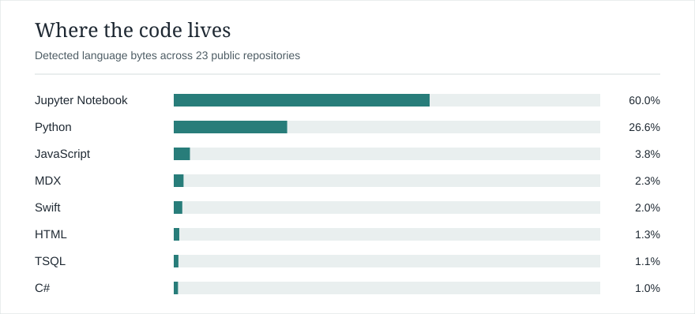

# Marsha Nabilah

I build software and explore machine learning, data, and web technologies.

## Tech stack

<!-- tech-stack:start -->
<a href="https://marshanabilah.github.io/stack/">
  <picture>
    <source media="(prefers-color-scheme: dark)" srcset="assets/tech-stack-dark.svg">
    <source media="(prefers-color-scheme: light)" srcset="assets/tech-stack-light.svg">
    
  </picture>
</a>

[Open the interactive repository breakdown](https://marshanabilah.github.io/stack/)

Repository evidence for 23 public repositories

<strong>Jupyter Notebook · 60.0%</strong> <a href="https://github.com/marshanabilah/kaggle">kaggle</a> · <a href="https://github.com/marshanabilah/disaster-tweets">disaster-tweets</a> · <a href="https://github.com/marshanabilah/recommendation-system">recommendation-system</a>

<strong>Python · 26.6%</strong> <a href="https://github.com/marshanabilah/cross-lingual-evaluation">cross-lingual-evaluation</a> · <a href="https://github.com/marshanabilah/Pemrograman_Jaringan_E_Kelompok_6">Pemrograman_Jaringan_E_Kelompok_6</a> · <a href="https://github.com/marshanabilah/data_parser">data_parser</a> · <a href="https://github.com/marshanabilah/FP_KB">FP_KB</a> · <a href="https://github.com/marshanabilah/task3-pml">task3-pml</a> · <a href="https://github.com/marshanabilah/leetcode">leetcode</a> · <a href="https://github.com/marshanabilah/research-agent">research-agent</a> · <a href="https://github.com/marshanabilah/marshanabilah.github.io">marshanabilah.github.io</a> · <a href="https://github.com/marshanabilah/RAG-and-LangChain">RAG-and-LangChain</a> · <a href="https://github.com/marshanabilah/github.io-backend">github.io-backend</a> · <a href="https://github.com/marshanabilah/flask-random">flask-random</a> · <a href="https://github.com/marshanabilah/pytest">pytest</a>

<strong>JavaScript · 3.8%</strong> <a href="https://github.com/marshanabilah/Kuis2">Kuis2</a> · <a href="https://github.com/marshanabilah/pweb_quiz1">pweb_quiz1</a> · <a href="https://github.com/marshanabilah/marshanabilah">marshanabilah</a> · <a href="https://github.com/marshanabilah/task-manager">task-manager</a> · <a href="https://github.com/marshanabilah/marshanabilah.github.io">marshanabilah.github.io</a>

<strong>MDX · 2.3%</strong> <a href="https://github.com/marshanabilah/cross-lingual-evaluation">cross-lingual-evaluation</a>

<strong>Swift · 2.0%</strong> <a href="https://github.com/marshanabilah/gmail-api">gmail-api</a>

<strong>HTML · 1.3%</strong> <a href="https://github.com/marshanabilah/Kuis2">Kuis2</a> · <a href="https://github.com/marshanabilah/pweb_quiz1">pweb_quiz1</a> · <a href="https://github.com/marshanabilah/marshanabilah.github.io">marshanabilah.github.io</a> · <a href="https://github.com/marshanabilah/task-manager">task-manager</a> · <a href="https://github.com/marshanabilah/flask-random">flask-random</a>

<strong>TSQL · 1.1%</strong> <a href="https://github.com/marshanabilah/C4C">C4C</a>

<strong>C# · 1.0%</strong> <a href="https://github.com/marshanabilah/Kuis2">Kuis2</a>

<!-- tech-stack:end -->

<!-- Keep your profile content outside the generated tech-stack section. -->
